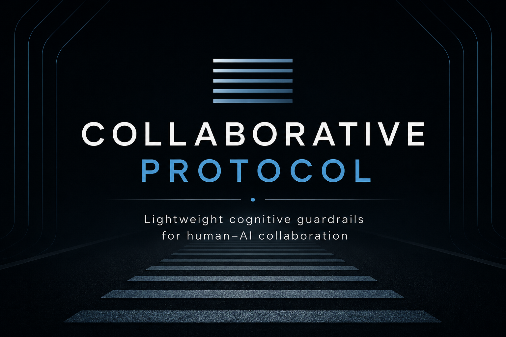

  

# Extended Collaborative Protocol (PCE)
### Protocollo Collaborativo Esteso

**Current version: 2.2 — Production / operational version**

A practical framework for more rigorous, efficient, context-aware human–AI technical collaboration. The PCE is designed to improve decisions, reduce costly errors and cognitive drift, and lower the cognitive cost of collaboration and context transfer. **It serves the work; it is not a substitute for judgment or a guarantee of correctness.**

## Read the protocol / Leggi il protocollo

- **[Italiano — PCE v2.2 (authoritative text)](Protocollo_Collaborativo_Esteso_v2.2.md)**
- **[English — Extended Collaborative Protocol v2.2 (translation)](Collaborative_Protocol.md)**

**Source of truth:** the Italian v2.2 text is reproduced from the operational document dated as version 2.2. The English text is a translation intended to make the protocol accessible internationally; in case of interpretive differences, consult the Italian original. The specification is distinct from this explanatory README.

**Testo di riferimento:** il documento italiano v2.2 è riprodotto dall'originale operativo. La versione inglese è una traduzione; in caso di divergenze interpretative prevale il testo italiano. Il README è materiale descrittivo, non parte della specifica.

## What it contains

The PCE combines four layers:

1. **Principles:** evidence before conclusions, focus on the actual problem, explicit assumptions, behavioral verification, output-oriented work, and proportional rigor.
2. **Rumble Strips (RS0–RS6):** lightweight corrective heuristics for context, problem framing, evidence, decision assumptions, behavior, outputs, and the method itself.
3. **Communication conventions:** transfer the operational delta concisely, without sacrificing accuracy or completeness.
4. **Operational artifacts:** Bundle, Recap, Knowledge, and Operational Prompt for auditability and continuity across sessions and tools.

**Principle Zero:** the cost of verification should be proportionate to the risk and less than the error it helps prevent. If a rule creates more friction than value, review or simplify it.

The protocol also addresses **proportionate model and reasoning-effort selection**: recommend the least costly configuration that preserves the required quality, leaving the final decision to the user.

## Applying it

Read the specification, assess risk and available context, and use a Rumble Strip only when its expected benefit exceeds the interruption cost. The sequence is **Evidence → Conclusion → Decision → Action**. Corrections should be specific and limited; once the drift is addressed or the risk accepted, resume the task.

The PCE is a set of operational heuristics, not a mandatory checklist, universal methodology, or proof of superior reasoning.

## Version history

- **2.2:** compact consolidation of v2.1; removed the Activation section and redundant Foundational Scars; retained the substantive model.
- **2.1:** bidirectional model/reasoning-effort selection based on task needs and cost.
- **2.0:** merged the Collaborative and Communication Protocols; introduced the unified operational-artifact structure.
- **1.3 and earlier:** initial Collaborative Protocol and Rumble Strips (available through [repository history](../../commits/main/Collaborative_Protocol.md)).

The complete v2.x changelog is included in each v2.2 specification. Earlier releases remain accessible in Git history; old activation keywords are **not** current v2.2 guidance.

The previous README documented work with GPT-5.5, GPT-5.6, and Codex during earlier iterations. That historical account is not a claim of independent external validation of the current v2.2 publication.

## Repository contents

| File | Purpose |
| --- | --- |
| [Protocollo_Collaborativo_Esteso_v2.2.md](Protocollo_Collaborativo_Esteso_v2.2.md) | Authoritative Italian specification |
| [Collaborative_Protocol.md](Collaborative_Protocol.md) | English translation, maintaining the original file path for existing links |
| [README.md](README.md) | Bilingual entry point and version information |
| [Collaborative_Protocol.png](Collaborative_Protocol.png), [cover.png](cover.png) | Existing visual assets |
| [LICENSE](LICENSE) | MIT license |

## License

MIT — see [LICENSE](LICENSE).
